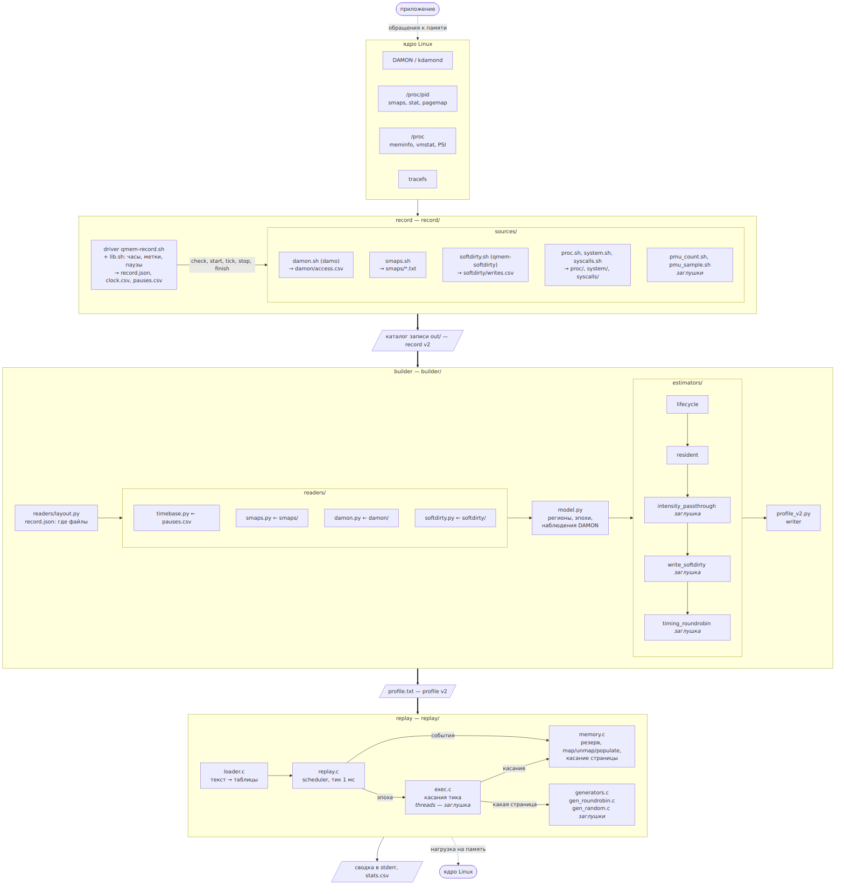
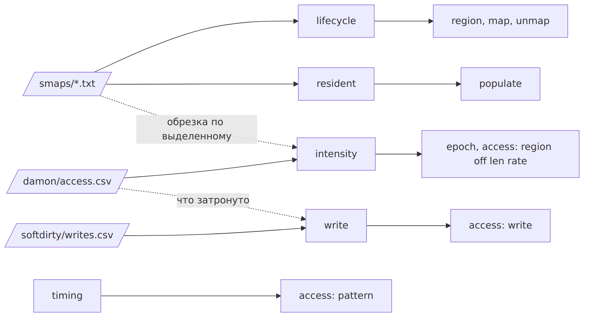
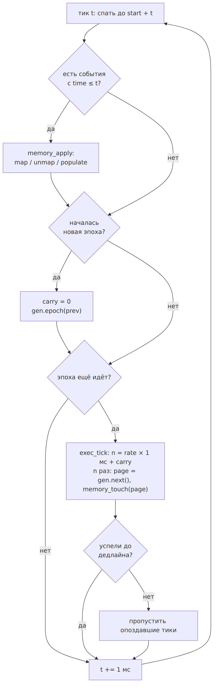

# Архитектура: модули и датафлоу

Три программы, между ними только файлы двух форматов: запись ([record v2](formats/record.md)) и [profile v2](formats/profile.md). Подробности каждой части — в [skeleton.md](skeleton.md) и README модулей.

Картинки собираются из исходников в `docs/diagrams/` командой `make diagrams` (нужен [mermaid-cli](https://github.com/mermaid-js/mermaid-cli): `mmdc`).

## Общая схема

Исходник: [diagrams/overview.mmd](diagrams/overview.mmd)

## Откуда каждое поле profile

Исходник: [diagrams/fields.mmd](diagrams/fields.mmd)

## Внутри replay: один тик

Исходник: [diagrams/replay-tick.mmd](diagrams/replay-tick.mmd)

## Точки расширения

| Где | Что добавить | Как |
| --- | --- | --- |
| record | Источник | `record/sources/<имя>.sh` с `check/start/tick/stop/finish/manifest` и имя в `ALL_SOURCES` |
| builder | Reader | `builder/readers/<источник>.py` и поле в `model.py` |
| builder | Оценщик | `builder/estimators/<вид>_<имя>.py`, выбор `--intensity/--write/--timing <имя>` |
| profile | Поле или тип строки | Новый ключ; старый replay пропустит его (или откажется, если ключ с `!`) |
| replay | Генератор | `replay/gen_<имя>.c` и строка в `generators.c`, выбор `pattern=<имя>` |
