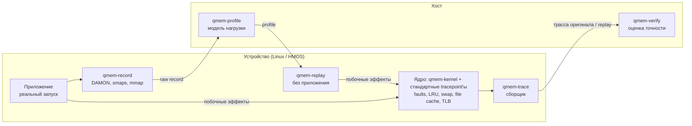
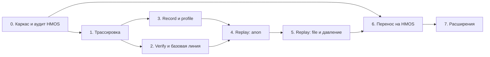

# Qmem — архитектура и план реализации

2026-10-09 · Daniel Lysyi · черновик

Что такое Qmem и зачем он нужен, описано в [spec.md](spec.md). Здесь — как его построить: модули, форматы данных и план работ. Код ещё не написан, план начинается с нуля.

## Обзор

Qmem — это шесть независимых модулей и CLI, который их связывает. Вместе они записывают нагрузку приложения на память, воспроизводят её без приложения и проверяют, что в ядре возникают те же побочные эффекты: page faults, LRU, swap, файловый кэш, TLB.

Принципы:

- **Сначала измерение, потом replay.** Без трассировки нечем проверить точность. Поэтому трассировка и сравнение делаются первыми.
- **Модули связаны только форматами файлов.** Каждый модуль можно делать, тестировать и заменять отдельно.
- **На устройстве — только маленькие бинарники на C без зависимостей.** Анализ идёт на хосте, на Python. На HMOS может не оказаться Python, а лишняя нагрузка на устройстве искажает измерения.
- **Минимум правок ядра.** Сначала стандартные tracepoint'ы, счётчики и eBPF. Свои tracepoint'ы добавляются, только если без них не обойтись. Так меньше зависимость от прав на сборку ядра HMOS.
- **Проверка на синтетике с известным ответом.** Прежде чем гонять настоящие приложения, каждый шаг проверяется на тестовых нагрузках, чей паттерн известен заранее.
- **Переиспользование готового.** DAMON для паттерна обращений, `damo replay` как отправная точка для replay, подход damoLoad для сравнения.

## Архитектура



Цикл работы:

1. Запустить приложение. `qmem-record` записывает его нагрузку, а `qmem-trace` в это же время снимает трассу оригинала.
2. На хосте `qmem-profile` строит из записи profile.
3. На устройстве `qmem-replay` воспроизводит profile, а `qmem-trace` снимает трассу replay.
4. На хосте `qmem-verify` сравнивает две трассы и выдаёт отчёт о точности.

## Модули

| Модуль | Где | Ответственность | Вход | Выход | Язык |
| --- | --- | --- | --- | --- | --- |
| `qmem-kernel` | Ядро | Distress-события: задержка page fault, direct reclaim, swap-in выше порога. Порог задаётся через sysctl | — | События в tracefs | C: патч ядра; запасной вариант — eBPF (kprobe/kretprobe) |
| `qmem-trace` | Устройство | Снимает счётчики (`/proc/vmstat`, PSI, `/proc/meminfo`, perf TLB для pid) с фиксированным интервалом. Включает нужные tracepoint'ы и сливает события | pid или cgroup, конфиг метрик | Трасса | C |
| `qmem-record` | Устройство | Запускает приложение или подключается к нему. Пишет DAMON, снимки smaps, mmap/munmap/brk, состояние памяти системы | pid или команда | Raw record | C ([подробнее](modules/record.md)) |
| `qmem-profile` | Хост | Превращает сырую запись в модель нагрузки: регионы, тип памяти, интенсивность обращений по эпохам, выделения, целевое давление | Raw record | Profile | Python |
| `qmem-replay` | Устройство | Воспроизводит profile: выделяет регионы (anon / file / THP), обращается к ним по таймлайну, делает mmap/munmap и держит давление на память (cgroup `memory.max` или балластная нагрузка) | Profile | Нагрузка на устройстве | C ([подробнее](modules/replay.md)) |
| `qmem-verify` | Хост | Сравнивает две трассы: итоги, динамику, распределения задержек. Считает баланс шума по базовой линии | Две трассы (+ базовая линия) | Отчёт | Python (pandas, scipy, matplotlib) |
| `qmem` (CLI) | Хост | Связывает модули: заливает бинарники на устройство (`hdc` / `adb` / ssh), запускает шаги, забирает результаты | Команда | — | Python |

Кроме модулей нужны **тестовые нагрузки** (`workloads/`). Это маленькие программы с заранее известным паттерном: анонимная память, файловая, смешанная, с фазами. Они служат ground truth для проверки record, profile и replay. Генератор нагрузок `memtest` из damoLoad можно взять за основу.

## Интерфейсы и форматы данных

Модули обмениваются каталогами с файлами. В каждом каталоге лежит `meta.json` с версией формата, устройством, версией ядра, временем старта и интервалом. Это позволяет менять модули независимо и сравнивать прогоны.

### Трасса (`qmem-trace` → `qmem-verify`)

```
trace/
  meta.json        # формат, устройство, ядро, pid/cgroup, интервал (мс)
  counters.csv     # ts_ms, metric, value — счётчики по интервалам
  events.txt       # сырой вывод tracefs (distress, vmscan, filemap, ...)
```

Сырые события парсятся на хосте, чтобы не нагружать устройство.

### Raw record (`qmem-record` → `qmem-profile`)

```
record/
  meta.json
  damon/           # снимки регионов DAMON по времени
  smaps/           # периодические снимки /proc/<pid>/smaps
  syscalls.txt     # mmap/munmap/brk/madvise с аргументами и ts
  system.csv       # /proc/meminfo и PSI во время записи
```

### Profile (`qmem-profile` → `qmem-replay`)

```json
{
  "version": 1,
  "epoch_ms": 100,
  "regions": [
    {"id": 0, "kind": "anon", "size": 268435456, "thp": false},
    {"id": 1, "kind": "file", "size": 67108864, "file_size": 67108864}
  ],
  "events": [
    {"t": 0, "op": "map", "region": 0},
    {"t": 5200, "op": "unmap", "region": 1}
  ],
  "epochs": [
    {"t": 0, "access": [{"region": 0, "offset": 0, "len": 4194304, "rate": 1200, "write_ratio": 0.3}]}
  ],
  "system": {"free_target_bytes": [{"t": 0, "value": 524288000}]}
}
```

Чтобы replay не разбирал JSON на устройстве, `qmem` перед заливкой конвертирует profile в компактный бинарный вид. JSON остаётся основным форматом для просмотра и отладки.

### Отчёт (`qmem-verify`)

```
report/
  report.md        # сводка: метрика, оригинал, replay, расхождение, базовый шум, ok/не ok
  metrics.json     # те же числа для автоматики
  plots/           # ряды во времени и гистограммы задержек
```

## Структура репозитория

```
qmem/
  docs/            # spec.md, architecture.md
  kernel/
    patches/       # qmem_distress: tracepoint'ы и sysctl
    bpf/           # запасной вариант на eBPF
  device/          # C, кросс-сборка под aarch64
    trace/
    record/
    replay/
    common/        # чтение конфигов, таймеры, запись файлов
  host/
    qmem/          # Python-пакет: cli, profile, verify, parsers
  workloads/       # тестовые нагрузки с известным паттерном
  tests/           # unit-тесты и сквозные тесты на workloads
  Makefile
```

## План реализации

Этапы 0–5 идут на обычном Linux. Этап 6 переносит всё на HMOS. Аудит возможностей ядра HMOS делается на этапе 0, чтобы рано узнать, чего там нет.



### 0. Каркас и аудит HMOS

- [ ] Репозиторий по структуре выше, `Makefile` с кросс-сборкой под aarch64, заготовка CLI.
- [ ] Тестовые нагрузки: anon, file, смешанная, с фазами.
- [ ] Аудит ядра HMOS: версия, есть ли DAMON, tracefs, нужные tracepoint'ы, eBPF, PSI, cgroup v2, zram, THP.
- [ ] Запросить права на сборку ядра HMOS.

**Готово, когда:** всё собирается, нагрузки работают на Linux, есть таблица возможностей HMOS.

### 1. Трассировка

- [ ] `qmem-trace`: счётчики по интервалам и включение стандартных tracepoint'ов (vmscan, filemap).
- [ ] `qmem-kernel`: distress-событие для page faults. На Linux сразу как патч; параллельно — вариант на eBPF, если на HMOS не будет прав на сборку.
- [ ] Distress-события для direct reclaim и swap-in тем же способом.
- [ ] Измерить накладные расходы: тестовая нагрузка с трассировкой и без.

**Готово, когда:** для каждой тестовой нагрузки снимается полная трасса, а накладные расходы известны и приемлемы.

### 2. Verify и базовая линия

- [ ] Парсеры трассы на хосте.
- [ ] Сравнение итогов, рядов во времени и распределений задержек.
- [ ] Отчёт `report.md` + `metrics.json`.
- [ ] Базовая линия: несколько прогонов одной нагрузки против себя.

**Готово, когда:** для двух прогонов одной нагрузки выдаётся отчёт и измерен естественный шум каждой метрики.

### 3. Record и profile

- [ ] `qmem-record`: DAMON через sysfs, снимки smaps, трассировка mmap/munmap/brk/madvise, состояние системы.
- [ ] `qmem-profile`: регионы, тип памяти, интенсивность обращений по эпохам, события выделения.
- [ ] Бинарный формат profile для устройства.

**Готово, когда:** profile тестовой нагрузки совпадает с её известным паттерном.

### 4. Replay: анонимная память

- [ ] `qmem-replay`: anon-регионы, обращения по эпохам, mmap/munmap по таймлайну.
- [ ] Сквозной цикл через CLI: record → profile → replay → verify.

**Готово, когда:** на anon-нагрузках faults и LRU у replay расходятся с оригиналом не больше базового шума.

### 5. Replay: файловая память и давление

- [ ] Файловые регионы на файлах-заглушках того же размера.
- [ ] Давление на память: cgroup `memory.max` или балластная нагрузка до того же уровня свободной памяти.

**Готово, когда:** swap и метрики файлового кэша на тестовых нагрузках укладываются в базовый шум.

### 6. Перенос на HMOS

- [ ] Сборка бинарников и патча ядра под устройство, доставка через `hdc`.
- [ ] Замена того, чего нет на HMOS (по итогам аудита).
- [ ] Полный цикл на одном реальном приложении.

**Готово, когда:** для реального приложения на HMOS есть отчёт о точности.

### 7. Расширения

- [ ] TLB и THP.
- [ ] Сценарии из нескольких приложений и фон.
- [ ] Зафиксировать допуски точности.

## Риски и открытые вопросы

| Риск | Что делать |
| --- | --- |
| Нет прав на сборку ядра HMOS | Вариант на eBPF и стандартных tracepoint'ах; аудит на этапе 0 |
| На HMOS нет DAMON | Паттерн обращений из других источников: idle page tracking, сэмплирование PMU |
| Трассировка меняет поведение приложения | Фильтры в ядре, анализ на хосте, замер накладных расходов на этапе 1 |
| Разрешения DAMON не хватает для точного replay | Подбор параметров регионов (опыт damoLoad) |
| Фон системы не воспроизводится | Прогоны в cgroup с фиксированным лимитом |

Открытые вопросы:

- Что на входе: одно приложение или сценарий из нескольких?
- Replay работает на том же устройстве или должен переноситься на другие?
- Какой допуск точности приемлем и кто его утверждает?
- Как доставлять бинарники на устройство: `hdc`, `adb` или что-то ещё?
