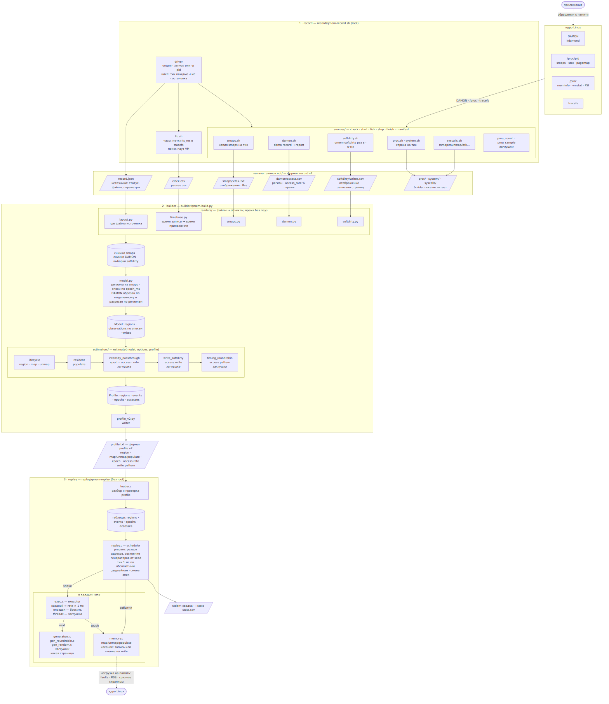

# Архитектура

Датафлоу через record, builder и replay и устройство каждого модуля. Прямоугольник — код, параллелограмм — файл на диске, цилиндр — данные в памяти.

Исходник: [architecture.mmd](architecture.mmd). Пересобрать картинку: `make diagrams` (нужен [mermaid-cli](https://github.com/mermaid-js/mermaid-cli)).
