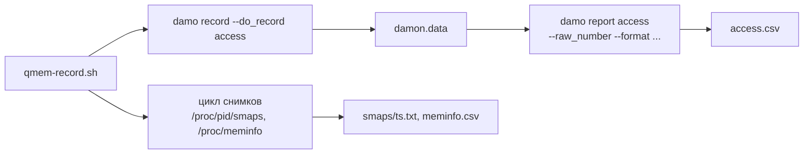

# qmem-record — итерация 1

2026-10-09 · черновик · общая схема: [architecture.md](../architecture.md)

В первой итерации `qmem-record` — shell-скрипт. Данные берутся из двух источников:

- **Паттерн обращений (DAMON)** — через damo: `damo record` пишет, `damo report access` выдаёт нормализованную таблицу `access.csv`. Внутренний формат `damon.data` Qmem напрямую не читает, поэтому смена формата в damo нас не ломает.
- **Всё остальное** — сам скрипт: снимки `/proc/<pid>/smaps` (тип и RSS регионов) и `/proc/meminfo` (память системы).

Работаем на обычном Linux, перенос на HMOS — потом.

## Интерфейс

```
qmem-record.sh -o <dir> [-i <ms>] -- <command> [args...]

  -o <dir>   каталог для результата
  -i <ms>    период снимков smaps и meminfo (по умолчанию 1000)
```

Запись заканчивается, когда приложение завершилось или пришёл Ctrl+C.

## Как работает



1. Запускает в фоне `damo record --do_record access -o "$dir/damon.data" "$command"`. Остальные виды записи damo (`cpu_profile`, `mem_footprint`, `vmas`, `proc_stats`) отключены: они нам не нужны и добавляют накладные расходы.
2. Узнаёт pid приложения (дочерний процесс `damo`).
3. Раз в `-i` мс, пока приложение живо:
    - копирует `/proc/<pid>/smaps` в `smaps/<ts_ms>.txt`;
    - дописывает строку в `meminfo.csv`: `ts_ms, MemFree, MemAvailable, Cached, SwapFree`.
4. Ctrl+C передаётся `damo`, и тот сам корректно завершает запись.
5. После записи вызывает `damo report access` и пишет `access.csv`, затем `meta.json`.

Все метки времени отсчитываются от одного старта, чтобы снимки smaps совмещались со снимками DAMON.

### Нормализация DAMON

```sh
damo report access -i "$dir/damon.data" --raw_number \
    --format set record_head   "" \
    --format set snapshot_head "snapshot <start time> <end time>" \
    --format set region        "<start address> <end address> <access rate> <access hz> <age>" \
    --format set snapshot_tail "" \
    --format set record_tail   "" \
  | awk '...' > "$dir/access.csv"   # подставляет время снимка в строки регионов
```

`--format` повторяется для каждой части отчёта. Время снимка отсчитывается от начала записи, `age` — в микросекундах, `access_rate` — в процентах от максимума, `access_hz` — частота обращений в герцах.

`qmem-record.sh --normalize <dir>` пересобирает `access.csv` из уже записанного `damon.data`.

## Результат

```
record/
  meta.json        # команда, версия damo, ядро, время старта и конца, интервал снимков
  damon.data       # запись damo (внутренний формат, напрямую не читаем)
  access.csv       # snapshot_start_ns, snapshot_end_ns, start, end, access_rate, access_hz, age
  smaps/<ts>.txt   # снимки /proc/<pid>/smaps
  meminfo.csv      # ts_ms, MemFree, MemAvailable, Cached, SwapFree (кБ)
```

## Требования

Linux с DAMON (`CONFIG_DAMON_VADDR`, `CONFIG_DAMON_SYSFS`), `damo` (проверено на 3.3.0), root.

## План

- [ ] **R1.** Скрипт: `damo record` в фоне, цикл снимков smaps и meminfo, проброс Ctrl+C, `meta.json`. *Готово:* `qmem-record.sh -o out -- ./workloads/hot_region` создаёт `damon.data`, снимки smaps и `meminfo.csv`.
- [ ] **R2.** Нормализация через `damo report access` в `access.csv`. *Готово:* горячий регион тестовой нагрузки виден в `access.csv` с высоким `access_rate`, а его адреса попадают в анонимное отображение из smaps.

## Отложено на следующие итерации

- Свой бинарник на C вместо скрипта (нужен для HMOS, где может не быть Python и `damo`).
- Подключение к уже работающему процессу.
- Трассировка mmap/munmap во времени.
- Отличие записи от чтения (soft-dirty).
- Замер накладных расходов.
