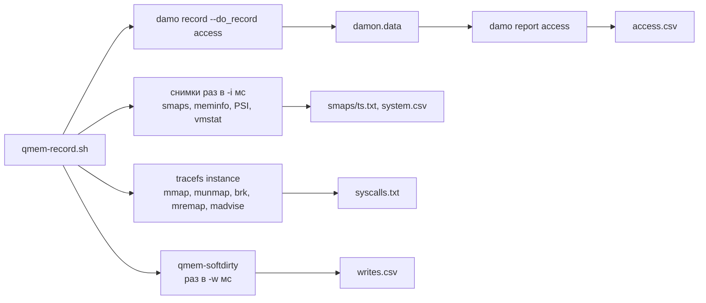

# qmem-record — итерация 1

2026-10-09 · черновик · общая схема: [architecture.md](../architecture.md)

В первой итерации `qmem-record` — shell-скрипт с маленьким помощником на C. Данные берутся из двух источников:

- **Паттерн обращений (DAMON)** — через damo: `damo record` пишет, `damo report access` выдаёт нормализованную таблицу `access.csv`. Внутренний формат `damon.data` Qmem напрямую не читает, поэтому смена формата в damo нас не ломает.
- **Всё остальное** — сам скрипт: снимки smaps, состояние памяти системы, трассировка выделений (tracefs) и доля записи (soft-dirty).

Работаем на обычном Linux, перенос на HMOS — потом.

## Интерфейс

```
qmem-record.sh -o <dir> [options] -- <command> [args...]   # запустить и записать
qmem-record.sh -o <dir> [options] -p <pid>                  # подключиться к процессу
qmem-record.sh --normalize <dir>                            # пересобрать access.csv

  -o <dir>         каталог для результата (пустой или несуществующий)
  -i <ms>          период снимков smaps и system.csv (по умолчанию 1000)
  -w <ms>          период замера доли записи через soft-dirty (по умолчанию выключено)
  -d <s>           остановиться через N секунд
  -D "<options>"   опции для damo record, например
                   "--monitoring_intervals 5ms 100ms 1s --monitoring_nr_regions_range 10 1000"
  --no-syscalls    не трассировать выделения
```

Запись заканчивается, когда процесс завершился, истекло `-d` или пришёл Ctrl+C. В режиме запуска приложение при остановке получает SIGTERM. В режиме `-p` его не трогаем.

## Как работает



1. Запускает `damo record --do_record access [-D options] -o damon.data <command | pid>`. Остальные виды записи damo отключены: они нам не нужны и добавляют накладные расходы.
2. Узнаёт pid приложения: в режиме запуска это первый дочерний процесс `damo`, в режиме `-p` — заданный pid.
3. Включает трассировку выделений (R3), если доступен tracefs и не задан `--no-syscalls`.
4. Запускает `qmem-softdirty`, если задан `-w` (R6).
5. Раз в `-i` мс копирует `/proc/<pid>/smaps` в `smaps/<ts_ms>.txt` и дописывает строку в `system.csv`.
6. На остановке передаёт `damo` SIGINT, выключает трассировку, дожидается всех помощников.
7. Вызывает `damo report access` и пишет `access.csv`, затем `meta.json`.

Все метки `ts_ms` отсчитываются от одного старта. События tracefs идут по часам `boot`. Для совмещения в `meta.json` пишется `start_uptime` — значение `/proc/uptime` в момент старта.

### Нормализация DAMON

```sh
damo report access -i "$dir/damon.data" --raw_number \
    --format set record_head   "" \
    --format set snapshot_head "snapshot <start time> <end time>" \
    --format set region        "<start address> <end address> <access rate> <access hz> <age>" \
    --format set snapshot_tail "" \
    --format set record_tail   "" \
  | awk '...' > "$dir/access.csv"   # подставляет время снимка в строки регионов
```

`--format` повторяется для каждой части отчёта. Время снимка отсчитывается от начала записи, `age` — в микросекундах, `access_rate` — в процентах от максимума, `access_hz` — частота обращений в герцах.

### Трассировка выделений (R3)

Свой экземпляр tracefs `instances/qmem-record-<pid скрипта>`, чтобы не мешать другим пользователям трассировки:

- часы `boot`, буфер 8 МБ на CPU;
- события `syscalls:sys_enter_*` и `sys_exit_*` для `mmap`, `munmap`, `brk`, `mremap`, `madvise`;
- фильтр по процессу через `set_event_pid` и опцию `event-fork`, чтобы попадали потоки и дети;
- `trace_pipe` переливается в `syscalls.txt` фоновым `cat`.

На остановке трассировка выключается, число потерянных событий (`overrun` из `per_cpu/*/stats`) пишется в `meta.json`, экземпляр удаляется. Нужен root. Без доступа к tracefs скрипт пишет предупреждение и продолжает без `syscalls.txt`.

Ограничение: приложение запускает damo, поэтому выделения в первые доли секунды, до включения трассировки, не попадают. То же верно и для DAMON.

### Доля записи (R6)

DAMON не отличает чтение от записи. `qmem-softdirty <pid> <period_ms> <start_ms>` раз в период:

1. читает `/proc/<pid>/maps` и для каждого отображения — биты из `/proc/<pid>/pagemap`: present (бит 63) и soft-dirty (бит 55);
2. пишет строку `ts_ms,start,end,present_pages,dirty_pages` для каждого отображения с present > 0;
3. сбрасывает soft-dirty записью `4` в `/proc/<pid>/clear_refs`.

`dirty_pages` — сколько страниц записали за прошедший период. Цена: после сброса каждая первая запись в страницу даёт лишний page fault. Поэтому замер выключен по умолчанию, а период лучше брать в несколько секунд.

## Результат

```
record/
  meta.json        # режим, команда или pid, версия и опции damo, ядро, время старта и конца,
                   # start_uptime, интервалы, причина остановки, syscalls, syscall_overrun
  damon.data       # запись damo (внутренний формат, напрямую не читаем)
  access.csv       # snapshot_start_ns, snapshot_end_ns, start, end, access_rate, access_hz, age
  smaps/<ts>.txt   # снимки /proc/<pid>/smaps
  system.csv       # ts_ms, MemFree, MemAvailable, Cached, SwapFree (кБ),
                   # psi_some_avg10, psi_full_avg10, pgfault, pgmajfault, pswpin, pswpout
  syscalls.txt     # сырой вывод tracefs (если трассировка доступна)
  writes.csv       # ts_ms, start, end, present_pages, dirty_pages (если задан -w)
```

## Требования

Linux с DAMON (`CONFIG_DAMON_VADDR`, `CONFIG_DAMON_SYSFS`), tracefs и `CONFIG_FTRACE_SYSCALLS` для R3, `CONFIG_MEM_SOFT_DIRTY` для R6, `damo` (проверено на 3.3.0), root.

## План

- [x] **R1.** Скрипт: `damo record` в фоне, цикл снимков smaps и meminfo, проброс Ctrl+C, `meta.json`.
- [x] **R2.** Нормализация через `damo report access` в `access.csv`, режим `--normalize`.
- [x] **R3.** Трассировка выделений через tracefs в `syscalls.txt`. *Готово:* mmap тестовой нагрузки с её размером виден в `syscalls.txt`; без root скрипт работает без трассировки.
- [x] **R4.** `system.csv` с PSI и счётчиками vmstat вместо `meminfo.csv`; опции damo через `-D`. *Готово:* в `system.csv` растёт `pgfault` во время нагрузки; опции попадают в вызов damo и в `meta.json`.
- [x] **R5.** Подключение к процессу `-p` и длительность `-d`. *Готово:* запись уже работающей нагрузки останавливается через `-d` секунд, процесс продолжает работать.
- [x] **R6.** Доля записи через soft-dirty, `-w`. *Готово:* у нагрузки, которая пишет в регион A и только читает регион B, почти все страницы A грязные, а B — почти нет.
- [x] **R7.** Замер накладных расходов: `tools/measure-overhead.sh`. *Готово:* измерены и записаны в этот документ.

## Накладные расходы (R7)

`tools/measure-overhead.sh` запускает команду `-n` раз как есть и `-n` раз под `qmem-record.sh` (вперемешку) и печатает медианы. Команда должна делать фиксированный объём работы, например `workloads/fixed_work`: тогда замедление видно как рост времени.

```sh
sudo tools/measure-overhead.sh -n 5 -r "-i 1000" -- ./workloads/fixed_work 512 600
```

Замер 2026-10-09: WSL2, ядро 6.18, damo 3.3.0, root, настоящий DAMON с интервалами по умолчанию (5 мс / 100 мс), 3–5 прогонов, медиана.

| Команда и опции | Без записи, с | С записью, с | Разница |
| --- | --- | --- | --- |
| `sleep 1`, `--no-syscalls` | 1.005 | 2.020 | +1.02 с |
| `sleep 1` | 1.004 | 2.406 | +1.40 с |
| `fixed_work 512 600`, `--no-syscalls` | 1.230 | 1.985 | +0.76 с |
| `fixed_work 512 600` | 1.346 | 2.386 | +1.04 с |
| `fixed_work 512 600`, `-w 2000` | 1.295 | 2.336 | +1.04 с |
| `fixed_work 512 600`, `-i 100 -w 200` | 1.447 | 3.494 | +2.05 с |
| `fixed_work 512 3000`, `--no-syscalls` | 5.865 | 7.146 | +1.28 с (+22 %) |
| `fixed_work 512 3000` | 5.954 | 7.490 | +1.54 с (+26 %) |

Выводы:

- **Фиксированная цена записи — около 1 с, с трассировкой около 1.4 с.** Это запуск damo и настройка DAMON, `damo report` и `damo version` после записи, а для трассировки — подготовка экземпляра tracefs и дочитывание буфера. Почти всё это приходится на время до старта и после завершения приложения и его самого не замедляет. `sleep 1` это и показывает: работы нет, а разница та же.
- **Само приложение под DAMON замедляется на несколько процентов.** На `fixed_work 512 3000` разница сверх фиксированной цены — около 0.2–0.3 с из 5.9 с.
- **Снимки smaps и `system.csv` почти ничего не стоят:** раньше это мерили с фейковым damo, и при `-i 1000` и `-i 100` получилось одно и то же.
- **Soft-dirty дорогой при частом сбросе.** `fixed_work` пишет во все страницы, и после каждого сброса каждая страница даёт лишний page fault: при `-w 200` вместе с `-i 100` это около +1 с сверху. Период — несколько секунд.
- `tools/measure-overhead.sh` меряет полное время работы вместе с запуском и завершением записи. Замедление самого приложения он показывает только на длинной команде с фиксированным объёмом работы.

### Что нашли прогоны под root

- **pid namespace.** В WSL (и в контейнерах) скрипт видит pid приложения внутри своего namespace, а tracefs фильтрует по pid ядра, поэтому `set_event_pid` ничего не ловил. Теперь pid ядра определяется через событие `signal:signal_generate` на безвредном SIGCONT и пишется в `meta.json` как `kernel_pid`. В нём же события в `syscalls.txt`.
- **Слишком короткие команды.** Если приложение завершается до первого снимка (`true`), damo падает и не пишет `damon.data`. Скрипт сообщает об этом понятной ошибкой.
- **Лишний файл.** damo кладёт рядом `damon.data.kdamonds` — конфигурацию DAMON, с которой шла запись. Qmem его не читает.

## Отложено на следующие итерации

- Свой бинарник на C вместо скрипта (нужен для HMOS, где может не быть Python и `damo`).
- Снимки smaps для дочерних процессов приложения.
- Экспериментальный режим DAMON `--exp_ops_write_only` как альтернатива soft-dirty.
