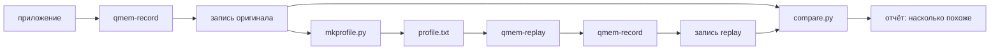

# qmem-replay — итерация 1

2026-10-12 · черновик · общая схема: [architecture.md](../architecture.md) · вход: [qmem-record](record.md) (`record-v0.1`)

Модуль из двух частей:

- **`tools/mkprofile.py`** (Python, на хосте) строит profile из каталога записи `qmem-record`.
- **`replay/qmem-replay`** (C, на устройстве) воспроизводит profile: выделяет анонимные регионы и касается их страниц с той же интенсивностью во времени.

Цель итерации — замкнутый цикл: **запись → profile → replay → запись replay → сравнение**. Без сравнения нельзя сказать, насколько replay похож на оригинал.

В этой итерации только анонимная память и один поток. Давление на память задаётся снаружи.

## Цикл работы



```sh
sudo record/qmem-record.sh -o orig -- ./my_app
tools/mkprofile.py orig -o profile.txt
sudo record/qmem-record.sh -o again -- replay/qmem-replay profile.txt
tools/compare.py orig again
```

Replay записывается тем же `qmem-record`. Поэтому сравниваются одни и те же файлы, снятые одинаково.

## Формат profile

Текст, одна запись на строку. Его легко читать человеку и разбирать в C без библиотек.

```
qmem-profile 1
epoch_ms 100
seed 42
region 0 315621376                  # id, размер в байтах (анонимная память)
region 1 2097152
map 0 0 0 315621376                # t_ms, region, offset, len: выделить часть региона
map 1200 1 0 2097152
epoch 0                             # t_ms начала эпохи; дальше её обращения
access 0 0 31457280 1536000 0.95    # region, offset, len, касаний страниц/с, доля записи
epoch 100
access 0 0 31457280 1536000 0.95
unmap 6400 0 0 210763776            # t_ms, region, offset, len: освободить часть
```

- Время в мс от старта replay. Эпохи без обращений не пишутся.
- Адреса не сохраняются: у replay свои адреса (ASLR), поэтому всё задаётся смещением внутри региона.
- `map` и `unmap` работают с частью региона: в примере python_phases VMA уменьшается с начала (с 303 до 110 МБ), а куча обычно растёт кусками. Регион — это непрерывный участок адресов, который приложение использовало за всё время записи.
- Эпоха длится `epoch_ms` от своего `t_ms`.

## qmem-replay (C)

```
qmem-replay <profile.txt> [--seed N] [--stats <file>]
```

| Компонент | Что делает |
| --- | --- |
| Loader | Читает profile целиком, проверяет версию, границы и порядок времени. Ошибка — код 2 и номер строки |
| Region manager | При первом `map` регион целиком резервируется (`mmap` с `PROT_NONE`, память не тратится). `map` части: `mmap(MAP_FIXED)` анонимной памяти на этот участок; `unmap`: снова `PROT_NONE` с `MAP_FIXED`, и ядро освобождает страницы. Для каждого региона две битовые карты страниц: «выделена» и «уже тронута». Касание невыделенной страницы пропускается и считается |
| Scheduler | Эпохи по `clock_nanosleep(CLOCK_MONOTONIC, TIMER_ABSTIME)` до абсолютного времени: сдвиг не накапливается. Не успели — остаток не переносится, отставание идёт в статистику |
| Access engine | `rate × epoch_ms / 1000` касаний на эпоху, страницы выбираются случайно (xorshift с seed) внутри `[offset, offset + len)`. Касания идут тиками по 10 мс, размазанные по эпохе, а не всплеском в её начале. Первое касание страницы — всегда запись (иначе ядро отдаст общую zero page и RSS не вырастет). Дальше в страницу пишут, если она входит в «пишущую» долю `write_ratio` участка (стабильный хэш номера страницы), иначе читают. Так доля записанных страниц за период совпадает с `write_ratio`, а не размывается случайностью |
| Stats | `--stats`: по эпохам план, сделано, отставание; в конце сводка в stderr |

Во время прогона replay не выделяет памяти и не делает лишних системных вызовов: всё готовится заранее.

## mkprofile.py (Python)

```
tools/mkprofile.py <record dir> -o <profile.txt> [--epoch-ms 100] [--seed 42]
```

| Что берёт | Откуда в записи | Как |
| --- | --- | --- |
| Регионы и их жизнь | `smaps/<ts>.txt` | Анонимные отображения (без файла, `[heap]`, `[stack]`). Регион — связный участок адресов, который покрывали анонимные отображения хотя бы в одном снимке. Что появилось к снимку → `map`, что пропало → `unmap`; время — из имени снимка |
| Интенсивность обращений | `access.csv` | Для эпохи берётся снимок DAMON, который покрывает её середину. Регион DAMON обрезается по выделенной части региона replay и переводится в смещение. Касаний в секунду = `access_rate / 100 × страниц / sample_interval` — столько, чтобы DAMON на replay увидел ту же частоту |
| Доля записи | `writes.csv` (если есть) | Записанный объём отображения за период, делённый на объём участков с обращениями в нём (не больше 1); без файла — 1.0 |
| Интервал сэмплирования | `damon.data.kdamonds` | `sample_us` |

Отображения файлов в этой итерации пропускаются; сколько их было, `mkprofile.py` печатает в сводке.

Формула интенсивности — допущение. Проверяется на шаге P5: если DAMON на replay видит другую частоту, формула меняется.

## compare.py (Python)

```
tools/compare.py <record оригинала> <record replay>
```

Сравнивает две записи по тому, что от адресов не зависит, и печатает таблицу «оригинал / replay / расхождение»:

| Метрика | Откуда |
| --- | --- |
| RSS анонимной памяти во времени | smaps |
| Объём горячей памяти по частоте обращений (сколько МБ с частотой >0, >50, >90%) во времени | `access.csv` |
| Прирост pgfault и pgmajfault, swap | `system.csv` |
| Доля записанных страниц | `writes.csv` |

Время выравнивается по первому заметному росту RSS: replay стартует чуть иначе, чем приложение.

## Тесты

Как в record: тесты пишутся до кода, для каждой группы шагов отдельный коммит. Без root проверяется сам replay и разбор файлов. С root — сквозной цикл с настоящим DAMON.

Синтетические profile с известным ответом:
- «256 МБ, каждая страница один раз за 10 с» → RSS ≈ 256 МБ, около 65 536 minor faults;
- «горячие 16 МБ из 256» → DAMON на replay видит горячий регион около 16 МБ;
- `unmap` половины региона → RSS падает вдвое в нужный момент.

## План

- [x] **P1. Ядро replay.** Разбор profile, `map`/`unmap`, цикл эпох с абсолютными дедлайнами, касания с первой записью, xorshift, сводка. *Готово:* profile «256 МБ за 10 с» даёт RSS ≈ 256 МБ и ≈ 65 536 minor faults; битый profile отклоняется с номером строки.
- [x] **P2. Точность времени и статистика.** Касания размазаны по эпохе, `--stats`, отставание. *Готово:* за 60 с прогона без перегрузки план выполнен ≥ 99%, отставание не копится.
- [x] **P3. Доля записи.** `write_ratio` в access. *Готово:* под `qmem-record -w` доля грязных страниц у replay совпадает с заданной (±5 п.п.).
- [ ] **P4. mkprofile.py.** Регионы и их жизнь из smaps, интенсивность из `access.csv`, доля записи из `writes.csv`. *Готово:* profile из записи `hot_region` содержит один регион нужного размера с горячим участком нужного размера; profile из `examples/python_phases` содержит выделение 300 МБ и освобождение 200 МБ в нужные моменты.
- [ ] **P5. compare.py и сквозной цикл.** *Готово (root):* `hot_region` → replay: горячая память, RSS и pgfault расходятся с оригиналом не больше чем на 20%. Если нет — правится формула интенсивности.
- [ ] **P6. Пример и замеры.** Сквозной цикл на `examples/python_phases`, результат сравнения в README примера; сколько ресурсов ест сам replay.

## Отложено на следующие итерации

- Файловая память (mmap файлов, page cache), THP, madvise.
- Многопоточность.
- Встроенное давление на память (cgroup, balloon); пока — снаружи, например `systemd-run -p MemoryMax=...`.
- Точные моменты выделений из `syscalls.txt` вместо снимков smaps.
- Бинарный формат profile.
