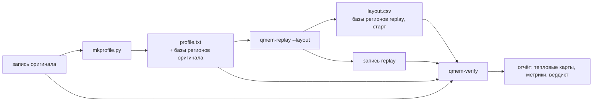

# qmem-verify — итерация 1

2026-10-12 · черновик · общая схема: [architecture.md](../architecture.md) · входы: [qmem-record](record.md), [qmem-replay](replay.md)

`qmem-verify` отвечает на вопрос, насколько replay похож на оригинал. Главная проверка — **по месту**: в тех же участках памяти и в то же время частота обращений должна быть примерно той же. Итоговые числа (пиковый RSS, page faults, доля записи) — дополнительная проверка, а не основная.

Модуль забирает сравнение из replay: `tools/compare.py` переезжает сюда и расширяется.

## Цикл



```sh
verify/cycle.sh -o run1 -- ./my_app            # весь цикл одной командой
# или по шагам:
sudo record/qmem-record.sh -o orig -- ./my_app
tools/mkprofile.py orig -o profile.txt
sudo record/qmem-record.sh -o again -- replay/qmem-replay profile.txt --layout layout.csv
verify/qmem-verify.py orig again --profile profile.txt --layout layout.csv
```

## Общая система координат

У replay другие адреса (ASLR), поэтому обе записи переводятся в координаты **регион + смещение + время от старта profile**.

| Запись | Регионы | Время 0 |
| --- | --- | --- |
| Оригинал | База каждого региона — в profile: `region <id> <size> <база в записи>`. replay третье поле пропускает | Старт записи оригинала: от него отсчитывает время mkprofile |
| Replay | `qmem-replay --layout <file>` пишет `region,base,size` для каждого региона и момент своего старта (`CLOCK_BOOTTIME`) | Старт replay; сдвиг относительно записи = старт replay − `start_uptime` из её `meta.json` |

Время выравнивается по точной метке, а не по росту RSS, как сейчас в `compare.py`.

## Главная проверка: тепловые карты

Для каждого региона строятся две карты, оригинала и replay:

- **ось времени** — корзины по `--time-bin` (по умолчанию 500 мс);
- **ось смещения** — 64 корзины на регион (меньше, если в регионе меньше 64 страниц);
- **значение** — частота обращений DAMON (`access_rate`, %), усреднённая по снимкам DAMON в этой корзине времени и взвешенная по байтам региона DAMON, попавшим в ячейку;
- **ячейки**, где память не выделена, в сравнение не идут.

Метрики, по каждому региону и по всем вместе (взвешенно по байтам):

| Метрика | Что показывает | Идеал |
| --- | --- | --- |
| Средняя ошибка частоты, п.п. | Насколько в среднем отличается частота в ячейке | 0 |
| Корреляция карт | Совпадает ли форма: где горячо, где холодно, когда | 1 |
| Полнота горячего | Какая доля байт, горячих у оригинала (частота ≥ 50%), горячая и у replay в той же ячейке | 1 |
| Точность горячего | Какая доля байт, горячих у replay, горячая и у оригинала | 1 |

Отчёт печатает карты регионов покрупнее текстом, рядом оригинал и replay: строки — время, столбцы — смещение, цифра 0–9 — частота по десяткам процентов. Так же сделано в damoLoad (`compare.py`, GT против DAMON), этот подход переиспользуется.

## Дополнительные проверки

| Проверка | Откуда | Как сравнивается |
| --- | --- | --- |
| RSS анонимной памяти во времени | smaps | Ряды по `--time-bin`: максимум, корреляция, наибольшее отклонение |
| Page faults приложения во времени | `proc.csv` | Итог и ряд прироста |
| Доля записи | `writes.csv` | Итог без первого замера; VMA с флагом `sd` в smaps (её пометили записанной целиком после munmap/mremap) исключаются |
| Под давлением памяти: swap-in/out, major faults, reclaim, refault | `system.csv` + новые колонки `pgscan_*`, `pgsteal_*`, `workingset_refault_*` | Итоги и ряды |

## Базовая линия шума

Два прогона самого оригинала тоже расходятся. `qmem-verify --baseline <orig1> <orig2>` считает те же метрики для двух записей оригинала. Регионы сопоставляются по порядку и размеру (±10%). Порог вердикта для replay — не фиксированные 20%, а «не больше k шумов оригинала» (k = 2, настраивается). Пока базовой линии нет, действуют абсолютные пороги по умолчанию.

## Давление на память

`verify/cycle.sh --memory-max <size>` запускает и оригинал, и replay в cgroup v2 с одинаковым `memory.max` (через `systemd-run --scope -p MemoryMax=...`). Лимит ниже рабочего набора вызывает reclaim и swap. Без этого побочные эффекты, ради которых делается Qmem (LRU, swap, file cache), в проверке не участвуют: на машине со свободной памятью swap и major faults равны нулю.

## Вывод и вердикт

- текстовый отчёт: сводная таблица, метрики по регионам, тепловые карты;
- `--json` — те же числа для автоматики;
- `--check` — код 1, если метрика за порогом. Пороги по умолчанию: ошибка частоты ≤ 10 п.п., корреляция ≥ 0.8, полнота и точность горячего ≥ 0.8, RSS и faults приложения ±20%. После V5 пороги считаются от базовой линии.

## Тесты

Как в record и replay: тесты до кода, коммит на шаг.

Синтетические записи с известным ответом:
- одинаковые записи — ошибка 0, корреляция 1;
- горячий участок у replay сдвинут в другое место региона — полнота и точность около 0, хотя суммарный объём горячей памяти совпадает (именно это пропускает нынешний `compare.py`);
- тот же участок, но в другое время — корреляция низкая;
- частота вдвое ниже — ошибка около половины частоты.

С root: сквозной цикл на `hot_region` и `rw_split`, под давлением и без.

## План

- [x] **V1. Перенос.** `tools/compare.py` → `verify/qmem-verify.py` с нынешними метриками и тестами; replay от сравнения освобождается. *Готово:* все нынешние проверки проходят в новом месте.
- [ ] **V2. Раскладка регионов.** mkprofile пишет базы регионов оригинала в profile; `qmem-replay --layout` пишет свои базы и момент старта. *Готово:* любой регион DAMON обеих записей переводится в (регион, смещение, время), время выровнено точно.
- [ ] **V3. Тепловые карты.** Построение карт, четыре метрики, текстовые карты в отчёте. *Готово:* синтетические случаи выше дают ожидаемые значения; на `hot_region` горячий участок replay совпадает с оригиналом по месту.
- [ ] **V4. Ряды во времени.** RSS и faults приложения по корзинам времени. *Готово:* replay, у которого нагрузка в другой фазе, проваливает проверку, хотя итоги совпадают.
- [ ] **V5. Базовая линия.** `--baseline`, пороги от шума. *Готово:* для `hot_region` и `python_phases` измерен шум оригинала, вердикт replay считается относительно него.
- [ ] **V6. Давление.** Колонки reclaim и refault в record, `cycle.sh --memory-max`, сравнение swap и reclaim. *Готово:* под лимитом swap и reclaim у replay и оригинала сопоставимы (в пределах порога).
- [ ] **V7. Набор нагрузок и отчёт.** Добавить нагрузки: случайный доступ, несколько горячих участков, смена фаз, рабочий набор больше лимита. Таблица результатов по всем — в этот документ.

## Отложено

- Файловая память и page cache: replay их пока не воспроизводит.
- Задержки page faults и reclaim (tracepoint `qmem_distress` из спеки).
- TLB.
