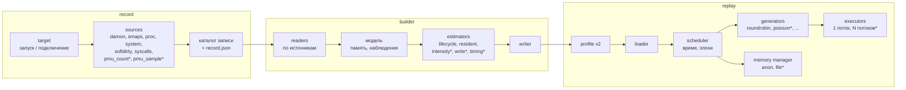

# Каркас record и replay

2026-10-13 · статус: на согласование

## Рамки

**Делаем:**
- record и replay;
- формат profile между ними;
- сборку profile из записи (builder);
- архитектурные шаблоны: где какие модули, какие у них интерфейсы, куда встают будущие источники данных и режимы replay.

Где логики пока нет — заглушка с зафиксированным интерфейсом.

**Не делаем сейчас:** verify, метрики, точность, сравнения и математику перевода записи в интенсивности (её место в каркасе есть, внутри заглушка).

**Платформа:** Linux. Перенос на HMOS — потом. Каркас при этом не должен ему мешать: на устройстве может не оказаться Python и damo.

**То, что уже работает** (qmem-record.sh, mkprofile.py, qmem-replay), переезжает в каркас как первые реализации модулей.

Точные форматы: [formats/record.md](formats/record.md), [formats/profile.md](formats/profile.md).

## 1. Общая схема



`*` — заглушка: интерфейс есть, логика простейшая или пустая.

Модули связаны только файлами: каталогом записи и profile. Каждый можно менять отдельно.

## 2. record

### 2.1 Устройство

| Часть | Что делает |
| --- | --- |
| **driver** | Разбор аргументов, запуск или подключение к цели (`target`), общий таймер снимков, остановка, `record.json` |
| **sources** | Источники данных. Каждый — отдельный модуль с одинаковым интерфейсом (2.2), включается и выключается опцией |
| **clock** | Общая шкала времени записи (`ts_ms`) и метки синхронизации с часами источников (как сейчас `clock.csv`) |

### 2.2 Интерфейс источника

Каждый источник лежит в `record/sources/<имя>.sh` (для Linux — bash; позже — C для устройства) и реализует функции `src_<имя>_check`, `_start`, `_tick`, `_stop` и `_manifest` (последняя печатает описание источника для `record.json`):

| Функция | Когда вызывается | Что делает |
| --- | --- | --- |
| `<имя>_check` | до старта | Проверяет, доступен ли источник (права, ядро, утилиты). Код 1 — источник пропускается с предупреждением |
| `<имя>_start <pid> <dir>` | после того как найдена цель | Запускает сбор: свой процесс, экземпляр tracefs и т. п. |
| `<имя>_tick <ts_ms>` | на каждом снимке driver | Для периодических источников — один снимок; остальные ничего не делают |
| `<имя>_stop` | на остановке, всегда | Останавливает сбор, дописывает файлы, отдаёт строку в манифест |

Источник пишет только в свой подкаталог `<dir>/<имя>/` и сообщает, какие файлы и в какой версии формата он создал.

### 2.3 Источники

| Источник | Что даёт | Состояние |
| --- | --- | --- |
| `damon` | Псевдочастоты регионов по времени (damo record + нормализация) | есть |
| `smaps` | Отображения и Rss процесса | есть |
| `proc` | Faults и RSS процесса | есть |
| `system` | Память системы, PSI, vmstat | есть |
| `softdirty` | Записанные страницы по отображениям | есть |
| `syscalls` | mmap/munmap/brk/mremap/madvise (tracefs) | есть |
| `pmu_count` | Общий счётчик обращений процесса (`perf_event_open`, подсчёт) | **заглушка**: `check` проверяет доступность PMU, без PMU источник пропускается |
| `pmu_sample` | Выборка адресов обращений (PEBS / SPE) | **заглушка** |

### 2.4 Каталог записи

```
<dir>/
  record.json          # манифест: версия, цель, время, источники и их файлы
  clock.csv, pauses.csv   # часы и паузы — общие для всей записи
  damon/  access.csv, damon.data, damon.data.kdamonds
  smaps/  <ts>.txt
  proc/   proc.csv
  system/ system.csv
  softdirty/ writes.csv
  syscalls/  syscalls.txt
  pmu_count/ ...       # когда появится
```

`record.json`:

```json
{
  "format": "qmem-record",
  "version": 2,
  "target": {"mode": "launch", "command": "...", "pid": 1234, "kernel_pid": 1234},
  "time": {"start_time": 1791554595.73, "start_uptime": 16772.57, "end_time": 1791554604.85,
           "paused_ms": 0, "pauses": "pauses.csv"},
  "sources": {
    "damon":  {"version": 1, "files": ["damon/access.csv"], "time_base": "record",
               "options": "..."},
    "smaps":  {"version": 1, "files": ["smaps/"], "interval_ms": 500},
    "pmu_count": {"status": "unavailable", "reason": "no hardware PMU"}
  }
}
```

Каждый, кто читает запись, по `sources` видит, что есть, в какой версии и чего нет.

Переход с нынешнего формата: файлы раскладываются по подкаталогам источников, `meta.json` заменяется на `record.json`. Builder читает и старый формат, чтобы прежние записи и примеры оставались рабочими.

## 3. builder (сборка profile)

### 3.1 Устройство

```
readers  →  модель  →  estimators  →  writer
```

| Часть | Что делает |
| --- | --- |
| **readers** | По одному на источник. Переводят файлы источника в общую модель: время записи с вычетом пауз, адреса. Нет источника — нет и его reader |
| **модель** | Промежуточные структуры: регионы и их жизнь (из smaps), наблюдения обращений по времени (из damon, позже pmu), записи (из softdirty) |
| **estimators** | Превращают модель в содержимое profile. Каждый — функция с фиксированным входом и выходом (3.2), выбирается опцией |
| **writer** | Пишет profile v2 (раздел 4) |

### 3.2 Estimators

| Estimator | Вход | Выход в profile | Сейчас |
| --- | --- | --- | --- |
| `lifecycle` | регионы по времени | `region`, `map`, `unmap` | есть: как в нынешнем mkprofile |
| `resident` | Rss по времени | `populate` | есть |
| `intensity` | наблюдения обращений (сейчас только DAMON) | поле `rate` в `access`: касаний на страницу в секунду | **заглушка `passthrough`**: псевдочастота DAMON без перевода. Место для будущих оценщиков, которые учтут счётчик, выборку и т. п. |
| `write` | наблюдения записей | поле `write` в `access` | **заглушка**: нынешняя доля по отображению |
| `timing` | — | поле `pattern` в `access`: как распределять касания во времени | **заглушка**: всегда `roundrobin` |

Интерфейс estimator'а — функция модуля Python:

```python
def estimate(model, options, profile) -> None
```

Estimator добавляет в `profile` свои строки (`lifecycle`, `resident`, `intensity`) или заполняет поля уже добавленных (`write`, `timing`). Порядок: lifecycle → resident → intensity → write → timing.

Новый оценщик — новый модуль `builder/estimators/<вид>_<имя>.py`; выбирается опцией `--intensity <имя>` (`--write`, `--timing`).

## 4. Формат profile v2

### 4.1 Решение

Текст, одна запись на строку, поля `ключ=значение`.
- **Почему текст:** читается глазами, легко разбирается в C без библиотек, расширяется добавлением ключей.
- **Почему `ключ=значение`, а не позиционные поля, как в v1:** новые поля не ломают старый replay, а порядок полей не важен.

Бинарный вариант для устройства — потом, отдельной сборкой из текста.

### 4.2 Правила совместимости

- Первая строка: `qmem-profile 2`. **Старшая версия** меняется только при несовместимых изменениях.
- **Неизвестный ключ** replay пропускает, неизвестный тип строки — тоже, с предупреждением. Новые поля добавляются без смены версии.
- Если без поля replay **не может** работать правильно, ключ пишется с `!`: `!pattern=poisson`. Тогда replay, не знающий ключ, отказывается работать.
- Обязательные ключи каждого типа строки перечислены в 4.4; replay проверяет их и сообщает номер строки при ошибке.

### 4.3 Пример

```
qmem-profile 2
meta source=rec1 builder=2 intensity=passthrough
meta epoch_ms=100 seed=42

region id=2 size=317898752 kind=anon base=0x74b7dfad4000
map t=1220 region=2 off=0 len=315801600
populate t=1220 region=2 off=0 len=315801600

epoch t=3000 dur=100
access region=2 off=284168192 len=32935936 rate=152.3 write=1.0 pattern=roundrobin

unmap t=6331 region=2 off=0 len=105267200

counter t=3000 name=pmu.loads value=0      # заглушка: пока никто не пишет и не читает
```

### 4.4 Типы строк

| Тип | Обязательные ключи | Необязательные | Смысл |
| --- | --- | --- | --- |
| `meta` | — | любые | Сведения о происхождении и параметрах; replay их игнорирует, кроме `epoch_ms`, `seed` |
| `region` | `id`, `size` | `kind` (`anon`; `file` — заглушка), `base` (адрес в оригинале), `file` | Регион памяти |
| `map`, `unmap`, `populate` | `t`, `region`, `off`, `len` | — | Жизнь памяти, как в v1 |
| `epoch` | `t` | `dur` (по умолчанию `epoch_ms`) | Начало эпохи; следующие `access` относятся к ней |
| `access` | `region`, `off`, `len`, `rate` | `write` (0..1, по умолчанию 0), `pattern` (по умолчанию `roundrobin`), `threads` (заглушка) | Обращения эпохи. `rate` — касаний **на страницу в секунду** |
| `counter` | `t`, `name`, `value` | — | Числовые ряды для будущих оценщиков и режимов (заглушка) |

Строка `access` из v1 (`access 0 0 4194304 1200 1.0`) — это `rate` на весь участок, а не на страницу. В v2 единица одна, на страницу: replay умножает на число страниц. Это убирает путаницу единиц.

## 5. replay

### 5.1 Устройство

| Часть | Что делает |
| --- | --- |
| **loader** | Разбор profile v2 (и v1 для старых файлов): правила 4.2, ошибки с номером строки |
| **memory manager** | Регионы: резерв, `map`/`unmap`/`populate`, битовые карты. Тип памяти — через `kind`: `anon` есть, `file` — заглушка (отказ с понятной ошибкой) |
| **scheduler** | Время: тики, абсолютные дедлайны, смена эпох, сброс невыполненной работы, статистика |
| **generators** | Как выбирать следующую страницу участка. Интерфейс 5.2, выбор по `pattern` |
| **executors** | Кто исполняет касания. Сейчас один поток; `threads` — заглушка (принимается, работает как 1, с предупреждением) |

### 5.2 Интерфейс генератора

```c
struct generator_ops {
	const char *name;                               /* значение pattern= */
	void (*init)(struct access *a, uint64_t seed);  /* при загрузке */
	void (*epoch)(struct access *a, const struct access *prev);  /* при смене эпохи */
	uint64_t (*next)(struct access *a);             /* номер следующей страницы участка */
};
```

| Генератор | Сейчас |
| --- | --- |
| `roundrobin` | есть: нынешний обход по кругу с продолжением между эпохами |
| `random` | **заглушка**: случайная равновероятная страница |
| `poisson` | **заглушка**: пока работает как `random` (моменты касаний — по тикам) |

Новый генератор — новый файл `replay/gen_<имя>.c` и строка в таблице генераторов.

### 5.3 Командная строка

```
qmem-replay <profile> [--seed N] [--stats <file>] [--layout <file>]
```

Без изменений; layout и точный лог (`QMEM_GT`) остаются.

## 6. Структура репозитория после перехода

```
record/
  qmem-record.sh         # driver
  sources/               # damon.sh smaps.sh proc.sh system.sh softdirty.sh syscalls.sh
                         # pmu_count.sh pmu_sample.sh (заглушки)
  softdirty.c            # помощник источника softdirty
builder/
  qmem-build.py          # бывший tools/mkprofile.py
  readers/               # layout (v1/v2) timebase smaps damon softdirty
  model.py               # модель
  estimators/            # lifecycle resident intensity_passthrough write_softdirty timing_roundrobin
  profile_v2.py          # writer и reader формата v2
replay/
  replay.c               # loader, scheduler
  memory.c  gen_*.c  exec.c
  profile.h              # структуры формата
common/qmem_gt.h
docs/formats/            # record.md, profile.md — описания форматов
```

`verify`, `mkprofile`, инструменты оценки и примеры экспериментов удалены (есть в git до тега `skeleton-v0.1`). `tools/measure-overhead.sh` остаётся.

## 7. Заглушки

| Где | Заглушка | Как ведёт себя сейчас | Интерфейс зафиксирован |
| --- | --- | --- | --- |
| record | `pmu_count`, `pmu_sample` | `check` → нет PMU → источник пропущен, в `record.json` `status: unavailable` | 2.2 |
| builder | `intensity=passthrough` | `rate` = псевдочастота DAMON без перевода | 3.2 |
| builder | `write`, `timing` | Нынешнее поведение / всегда `roundrobin` | 3.2 |
| profile | `counter`, `threads`, `kind=file` | Пишутся или нет; replay принимает, не использует | 4.4 |
| replay | `random`, `poisson` | Случайная страница | 5.2 |
| replay | `threads` | Один поток, предупреждение | 5.1 |
| replay | `kind=file` | Понятная ошибка | 5.1 |

## 8. План

Тесты для каждого шага — до кода, как раньше. Тесты проверяют только, что каркас работает: файлы, форматы, интерфейсы, заглушки. Точность не проверяется.

1. **Описание форматов:** `docs/formats/record.md` и `docs/formats/profile.md` — по разделам 2.4 и 4.
2. **record:** driver + интерфейс источников; нынешний код разложить по `sources/`; `record.json`; заглушки PMU.
3. **builder:** readers, модель, estimators, writer v2; нынешняя логика mkprofile — первые реализации; заглушки estimators. Чтение старого формата записи.
4. **replay:** loader v2 (и v1), memory manager, интерфейс генераторов, `roundrobin` + заглушки, заглушка `threads`.
5. **Сквозной прогон каркаса:** record → build → replay на тестовой нагрузке. Проверяется только, что всё проходит и файлы на месте.

## 9. Дальше (после каркаса)

Из прежнего общего плана (`architecture.md`, есть в git до тега `skeleton-v0.1`):

- **Файловая память и давление.** Файловые регионы (`kind=file`) на файлах-заглушках того же размера. Давление на память — через cgroup `memory.max` или балластную нагрузку.
- **Перенос на HMOS.** Сборка под устройство, доставка через `hdc`, замена того, чего на HMOS нет.
- **Расширения.** TLB и THP; сценарии из нескольких приложений и фон.
- **Интенсивность.** Настоящие оценщики вместо `intensity=passthrough`: перевод псевдочастоты DAMON в частоту касаний, учёт PMU.

| Риск | Что делать |
| --- | --- |
| Нет прав на сборку ядра HMOS | Вариант на eBPF и стандартных tracepoint'ах |
| На HMOS нет DAMON | Источники `pmu_count`/`pmu_sample`, idle page tracking |
| Запись меняет поведение приложения | Фильтры в ядре, анализ на хосте, `tools/measure-overhead.sh` |
| Фон системы не воспроизводится | Прогоны в cgroup с фиксированным лимитом |

Открытые вопросы: одно приложение или сценарий из нескольких; replay на том же устройстве или переносимый; как доставлять бинарники на устройство.
