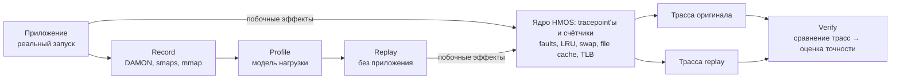

# Qmem — спецификация

2026-10-09 · Daniel Lysyi · черновик

## Назначение

Qmem записывает нагрузку приложения на память на устройстве с HMOS и затем воспроизводит её без самого приложения. Воспроизведение считается точным, если оно вызывает в ядре те же побочные эффекты, что и оригинал: page faults, движение страниц по LRU, swap, работу с файловым кэшем.

Зачем это нужно:

- **Повторяемость.** Одну и ту же нагрузку можно прогнать много раз и сравнить разные настройки ядра или политики управления памятью.
- **Независимость от приложения.** Не нужно запускать само приложение, его данные, сеть и сценарий пользователя.
- **Переносимость.** Записанную нагрузку можно воспроизвести на другом устройстве или ядре.

Статус: черновик. Документ составлен по описанию задачи «Tracing and Emulating Memory Side-Effects for Qmem» и комментарию Андрея Такмазяна от 2026-09-01. Всё, что не следует из них напрямую, помечено как допущение в последнем разделе.

## Термины

| Термин | Значение |
| --- | --- |
| Нагрузка по памяти | Всё, что приложение делает с памятью: выделение и освобождение (mmap/munmap, brk), обращения к страницам, чтение файлов |
| Access pattern | Какие регионы памяти и как часто приложение трогает во времени. Пример источника — DAMON |
| Побочные эффекты памяти (memory side-effects) | Реакция ядра на нагрузку: page faults и их задержка, перемещения по LRU, swap-in/out, вытеснение и повторная загрузка файлового кэша, TLB-промахи |
| Record | Запуск настоящего приложения со снятием его нагрузки и побочных эффектов |
| Profile | Результат записи: модель нагрузки, по которой работает replay |
| Replay | Искусственная нагрузка, построенная по profile, без исходного приложения |
| Точность (fidelity) | Насколько побочные эффекты replay совпадают с побочными эффектами оригинала |
| Distress-событие | Момент, когда ядро обслуживает память с трудом. Первый пример — page fault, чья обработка длилась дольше порога (tracepoint `qmem_distress`) |

## Цели и требования

Главное требование: replay должен вызывать в ядре те же побочные эффекты, что и оригинал. Совпадения одних только обращений к памяти недостаточно.

### Цели

1. **Запись.** Снимать нагрузку приложения на память на HMOS с накладными расходами, которые заметно не меняют поведение приложения.
2. **Трассировка побочных эффектов.** Измерять page faults, LRU, swap, файловый кэш и, по желанию, TLB — одинаково для оригинала и для replay.
3. **Воспроизведение.** По записи создавать нагрузку с теми же побочными эффектами.
4. **Оценка точности.** Автоматически сравнивать оригинал и replay и выдавать числовую оценку.

### Требования

- Трассировка фильтруется в ядре. Логировать каждое событие слишком дорого: это уже показал эксперимент с page faults.
- Фильтр отражает стоимость события для системы (например, задержку), а не его тип.
- Пороги фильтров настраиваются без пересборки ядра.
- Один и тот же набор tracepoint'ов работает на Linux (для прототипирования) и на HMOS.
- Replay воспроизводим: два прогона на одной машине дают близкие метрики.

### Вне рамок (пока)

- Нагрузка на CPU, GPU, сеть и диск, не связанная с памятью.
- Логика и данные самого приложения: воспроизводится только то, как оно нагружает память.
- Идеальное совпадение каждого события: сравниваются распределения и динамика во времени.

## Архитектура

Qmem состоит из четырёх шагов: Record, Profile, Replay и Verify. Оригинал и replay трассируются одним и тем же набором tracepoint'ов, поэтому их побочные эффекты можно сравнить напрямую.

| Компонент | Вход | Выход |
| --- | --- | --- |
| Record | Запущенное приложение (pid) | Сырые данные: DAMON, снимки smaps, mmap/munmap, состояние памяти системы |
| Profile | Сырые данные Record | Модель нагрузки: регионы, тип памяти, частота обращений и выделения во времени |
| Replay | Profile, целевой уровень давления на память | Искусственная нагрузка на устройстве |
| Трассировка | Любой процесс (оригинал или replay) | Счётчики и distress-события ядра |
| Verify | Трасса оригинала и трасса replay | Оценка точности по каждому побочному эффекту |

## Трассировка побочных эффектов

Для каждого эффекта снимаются два уровня данных: дешёвые счётчики (`/proc/vmstat`, PSI) за всё время прогона и отфильтрованные события для дорогих случаев. Сначала берём стандартные tracepoint'ы ядра, свои добавляем только там, где стандартных нет или они слишком шумные.

| Эффект | Счётчики | События | Что сравниваем | Статус |
| --- | --- | --- | --- | --- |
| Page faults | `pgfault`, `pgmajfault` в `/proc/vmstat`; perf `page-faults`, `major-faults` | Свой tracepoint `qmem_distress`: секундомер в `handle_mm_fault()`, лог только если задержка выше порога | Число minor/major за интервал; распределение задержек | Прототип на Linux готов; сборка HMOS ждёт прав |
| LRU | `pgactivate`, `pgdeactivate`, `pgscan_*`, `pgsteal_*` | `vmscan:mm_vmscan_lru_shrink_inactive`, `mm_vmscan_lru_shrink_active`, `mm_vmscan_direct_reclaim_begin/end`, `mm_vmscan_kswapd_wake` | Объём сканирования и вытеснения; число и длительность direct reclaim | Не начато |
| Swap | `pswpin`, `pswpout`; статистика zram, если он есть | Стандартных tracepoint'ов мало: kprobe на функции чтения и записи swap (имена зависят от версии ядра) или свой tracepoint | Объём swap-in/out во времени; задержка swap-in | Не начато |
| Файловый кэш | `workingset_refault_file`, `workingset_activate_file`, размер кэша в `/proc/meminfo` | `filemap:mm_filemap_add_to_page_cache`, `mm_filemap_delete_from_page_cache` | Число refault'ов (страница вытеснена и снова нужна); объём кэша | Не начато |
| TLB (опционально) | PMU: perf `dTLB-load-misses`, `iTLB-load-misses` (на ARM — соответствующие события PMU) | Не нужны: хватает счётчиков по процессу | Промахи на 1000 инструкций | Не начато |
| Общее давление | PSI: `/proc/pressure/memory` (some/full) | — | Доля времени, когда задачи ждут память | Не начато |

Все события пишут pid, comm и временную метку. По ним эффекты разделяются на вызванные самим приложением (или replay) и фоном системы.

### Page faults: текущая реализация

- `include/trace/events/qmem_distress.h` — описание события.
- `mm/qmem_distress.c` — точка включения и функция логирования.
- `mm/memory.c::handle_mm_fault()` — замер времени обработки; если оно выше порога, событие записывается.
- Нагрузка для отладки: `stress-ng --vm 4 --vm-bytes 95% --vm-keep`.

Поля события: адрес, флаги фолта, результат (`VM_FAULT_*`), задержка в наносекундах, pid, comm. Порог задаётся через sysctl или параметр. Тот же паттерн «замер + порог» применим к direct reclaim и swap-in.

## Эмуляция

Чтобы побочные эффекты совпали, replay должен воспроизвести не только обращения, но и тип памяти, выделения и состояние системы. Ниже — что именно и почему.

| Что воспроизводим | Какой эффект зависит | Как |
| --- | --- | --- |
| Паттерн обращений: регионы, частота, порядок во времени | LRU, minor faults, TLB | Чтение и запись страниц по profile, как в `damo replay` |
| Чтение и запись | Dirty-страницы, writeback, стоимость вытеснения | Доля записей по региону из profile |
| Тип памяти: анонимная или файловая | Swap (только anon) и файловый кэш (только file) | Анонимные регионы — anon mmap; файловые — mmap или read файлов-заглушек того же размера |
| Выделение и освобождение во времени | Рабочий набор, фолты первого касания | mmap/munmap в те же моменты, что и у оригинала |
| Размер страниц (THP) | TLB, стоимость фолта | `madvise` с теми же советами |
| Состояние системы: свободная память, фон | Swap, reclaim, задержка фолтов | Ограничение памяти через cgroup (`memory.max`) или фоновая нагрузка до того же уровня свободной памяти |

Источники данных для profile:

- **Паттерн обращений** — DAMON (`damo record`). Есть готовый replay, но он работает только с анонимной памятью.
- **Карта памяти** — периодические снимки `/proc/<pid>/smaps`: тип региона, RSS, swap по региону.
- **Выделения** — трассировка mmap/munmap/brk (syscall tracepoints).
- **Состояние системы** — `/proc/meminfo` и PSI во время записи.

Текущая нагрузка `stress-ng` — только средство отладить tracepoint'ы, а не эмуляция приложения. Она же может служить фоновой нагрузкой, создающей нужное давление на память.

## Верификация

Точность оценивается сравнением трасс оригинала и replay, снятых одним и тем же набором tracepoint'ов на одном устройстве при одинаковом исходном состоянии памяти. Сравниваются три вещи.

1. **Итоги за прогон.** Относительная разница по каждому счётчику: minor/major faults, pgscan, pgsteal, pswpin/pswpout, refault'ы, TLB-промахи.
2. **Динамика во времени.** Ряды тех же счётчиков по интервалам (например, 1 с) сравниваются корреляцией. Совпасть должны не только суммы, но и пики.
3. **Распределения задержек.** Гистограммы задержек из distress-событий (page faults, direct reclaim, swap-in): перцентили p50/p99 и расстояние между распределениями.

Базовая линия: два прогона самого оригинала тоже расходятся. Replay считается точным, если его расхождение с оригиналом не больше расхождения оригинала с самим собой. Конкретные допуски в процентах определяются после первых измерений.

Похожее сравнение уже есть в damoLoad: там ground truth нагрузки сравнивается с тем, что увидел DAMON. Инструменты сравнения и визуализации можно переиспользовать.

## План работ

Сейчас сделана часть этапа 1: tracepoint для page faults работает на Linux, сборка HMOS ждёт прав доступа. Этапы идут по порядку, но 2 и 3 можно вести параллельно.

1. **Трассировка на Linux.**
    - [x] Tracepoint `qmem_distress` для медленных page faults.
    - [ ] Порог через sysctl вместо константы.
    - [ ] Сбор LRU, swap, файлового кэша и PSI на стандартных tracepoint'ах и счётчиках.
    - [ ] Скрипт записи: один запуск снимает все метрики для заданного pid.
2. **Перенос на HMOS.**
    - [ ] Получить права на сборку ядра.
    - [ ] Собрать и проверить те же tracepoint'ы на устройстве.
    - [ ] Снять первые трассы реальных приложений.
3. **Record и profile.**
    - [ ] Запись паттерна обращений (DAMON) вместе с картой памяти и выделениями.
    - [ ] Формат profile.
4. **Replay.**
    - [ ] Анонимная память (на основе `damo replay`).
    - [ ] Файловая память.
    - [ ] Воспроизведение давления на память (cgroup или фоновая нагрузка).
5. **Верификация.**
    - [ ] Измерить базовую линию: оригинал против оригинала.
    - [ ] Автоматическое сравнение и отчёт.
    - [ ] Зафиксировать допуски.

## Допущения, открытые вопросы, риски

### Допущения

- Ядро HMOS достаточно близко к Linux, чтобы tracepoint'ы из `mm/` переносились с минимальными правками.
- В HMOS доступны DAMON, tracefs, PSI и cgroup v2.
- Swap на устройствах — скорее всего zram.
- Имена файлов `qmem_distress.h` / `qmem_distress.c` взяты из комментария и требуют подтверждения.
- Replay должен воспроизводить и давление на память в системе, а не только нагрузку самого приложения: без этого swap и reclaim не повторятся.

### Открытые вопросы

- Что на входе: одно приложение или сценарий из нескольких (фоновые приложения, переключения)?
- Нужно ли воспроизводить состояние системы или только нагрузку самого приложения?
- Replay работает на том же устройстве или должен переноситься на другие?
- Какой допуск точности считается приемлемым и кто его утверждает?
- Кто потребитель Qmem: разработчики ядра, тестировщики производительности, кто-то ещё?

### Риски

| Риск | Последствие | Что делать |
| --- | --- | --- |
| Нет прав на сборку ядра HMOS | Работа остаётся на Linux | Максимум сделать на стандартных tracepoint'ах и kprobe, которые не требуют пересборки |
| Накладные расходы трассировки меняют поведение приложения | Запись не соответствует обычной работе | Фильтры в ядре; измерить разницу с трассировкой и без неё |
| Разрешения DAMON не хватает для точного replay | LRU и фолты расходятся | Подобрать параметры регионов (опыт damoLoad) |
| Фон системы невоспроизводим | Swap и reclaim разные от прогона к прогону | Изолировать прогоны в cgroup с фиксированным лимитом |
