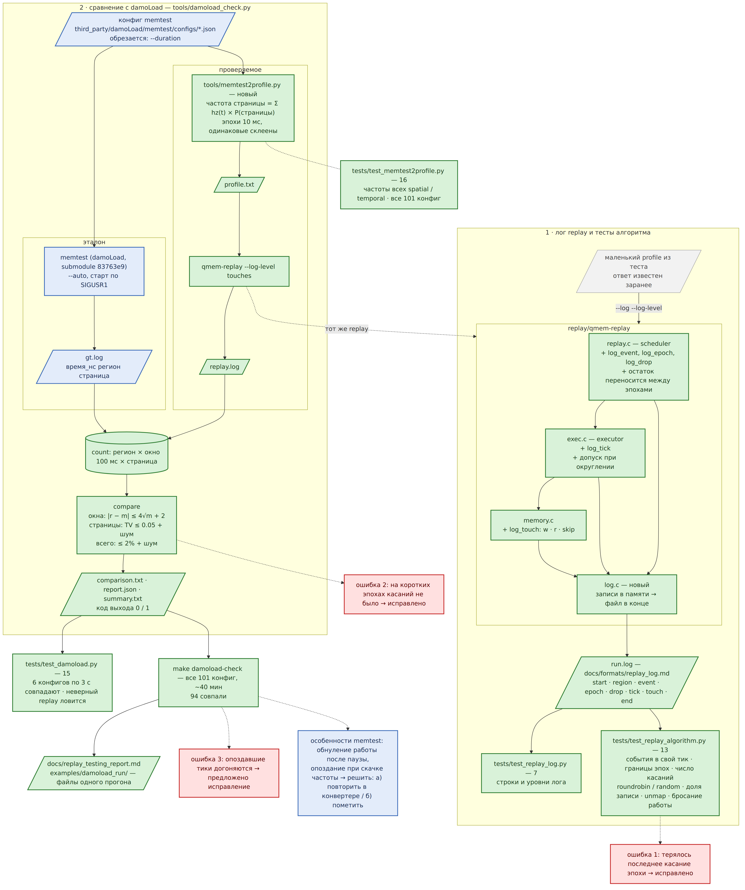

# Проверка replay: лог шагов, тесты алгоритма, сравнение с damoLoad

2026-10-20 · ветка `replay-testing` · подробный отчёт: [docs/replay_testing_report.md](../../docs/replay_testing_report.md) · план: [docs/replay_testing.md](../../docs/replay_testing.md)

## Зачем

Системы сравнения правдоподобия пока нет. Поэтому replay проверяется двумя способами:
1. **Делает ли он нужные шаги.** replay пишет лог своих шагов, тесты сверяют его с тем, что должно было произойти.
2. **Делает ли он то же, что эталонный нагрузчик.** memtest из [damoLoad](https://github.com/DanLyss/damoLoad) считается заведомо правильным. На суженном наборе нагрузок (его конфигах) replay сравнивается с ним касание в касание.

## Результат

- **Найдены и исправлены 2 ошибки replay**, ещё одна найдена, исправление предложено:

  | # | Ошибка | Как найдена | Статус |
  | --- | --- | --- | --- |
  | 1 | Терялось последнее касание эпохи: при сложении дробных касаний 100 × 1.92 давало 191.99999… | тест алгоритма | исправлено |
  | 2 | На коротких эпохах при низкой частоте касаний не было вообще: дробный остаток обнулялся в начале каждой эпохи | сравнение с damoLoad | исправлено |
  | 3 | Опоздавшие тики догоняются подряд, а не бросаются | сравнение с damoLoad, 5500 регионов | предложено |

- **94 из 101 конфига damoLoad совпали** по времени, страницам и объёму. Медиана расхождения в числе касаний — 0.12%. Из 7 несовпадений:
  - одно — ошибка 3;
  - четыре — memtest сам отступает от своего конфига;
  - два — единичные окна на очень низких частотах.

  Подробно: [measurements/](measurements/).



## Что делает дифф кода

Весь дифф: [code.diff](code.diff), 15 файлов, +1557 −29. На GitHub: [сравнение `4b476da...replay-testing`](https://github.com/DanLyss/qmem/compare/4b476da...replay-testing).

| Файл | Что изменено |
| --- | --- |
| `replay/log.c` (новый) | Лог шагов: записи копятся в памяти, в конце пишутся в файл. Формат: [docs/formats/replay_log.md](../../docs/formats/replay_log.md) |
| `replay/replay.c` | Опции `--log`, `--log-level`; запись событий, начала и конца эпох, брошенной работы. **Ошибка 2:** эпоха продолжает дробный остаток касаний того же участка из прошлой эпохи |
| `replay/exec.c` | Запись тиков. **Ошибка 1:** допуск при отбрасывании дробной части |
| `replay/memory.c` | Запись каждого касания: запись, чтение или пропуск невыделенной страницы. `memory_apply` возвращает, сколько страниц записал `populate` |
| `replay/profile.h` | Объявления лога |
| `tools/memtest2profile.py` (новый) | Конфиг memtest → profile v2. Частота каждой страницы = Σ по трекам `hz(t) × P(страницы)`, формулы как в коде memtest |
| `tools/damoload_check.py` (новый) | Запускает memtest и replay, сравнивает их логи по окнам, страницам и сумме. Пишет `comparison.txt` и `report.json` |
| `builder/profile_v2.py` | `rate` пишется с 6 знаками, а не с 3: у малых частот терялась точность |
| `Makefile` | `make damoload-check` — все 101 конфиг; диаграммы |
| `.gitmodules`, `third_party/damoLoad` | damoLoad как submodule на коммите `83763e9` |
| `tests/test_replay_log.py` (новый, 7) | Строки и уровни лога |
| `tests/test_replay_algorithm.py` (новый, 13) | Шаги алгоритма: события в свой тик, границы эпох, число касаний и перенос остатка, roundrobin и random, постоянный набор записываемых страниц, `unmap`, бросание опоздавшей работы |
| `tests/test_memtest2profile.py` (новый, 16) | Частоты при переводе для всех `spatial` и `temporal`; перевод всех 101 конфига |
| `tests/test_damoload.py` (новый, 15) | 6 конфигов по 3 с совпадают с memtest; replay с частотой ниже на 30% ловится; юнит-тесты сравнения |

## Как воспроизвести

```sh
git submodule update --init
make test                                            # все тесты, ~2.5 мин
python3 tools/damoload_check.py third_party/damoLoad/memtest/configs/08_hotspot_two_pages.json \
    --duration 3 --keep /tmp/run                     # один конфиг, файлы прогона в /tmp/run
make damoload-check                                  # все 101 конфиг, ~40 мин
```

Root и DAMON не нужны.

## Что осталось решить

1. Исправить ошибку 3: события `t=0` применять до запуска часов; тик, начавшийся позже дедлайна, бросать.
2. Особенности memtest — обнуление работы после паузы и опоздание при скачке частоты:
   - **а)** повторить их в конвертере, чтобы эталоном было фактическое поведение memtest;
   - **б)** помечать такие конфиги как несравнимые.
3. Порог по окнам сделать симметричным, `4√max(memtest, replay) + 2`, чтобы случайный 0 при ожидании около 1 не считался расхождением.
